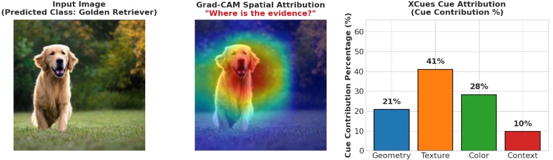

# Beyond Where, What Matters? Quantifying Visual Cue Contributions with XCues

**Anonymous Repository for Double-Blind Review**

This repository contains a minimal, self-contained implementation of **XCues**, a post-hoc, model-agnostic framework for quantifying visual cue contributions to individual predictions of pretrained image classifiers. *(Full multi-architecture benchmark and evaluation scripts will be released upon publication).*

Unlike spatial attribution methods (e.g., Grad-CAM) that highlight *where* evidence is located, XCues quantifies *what* visual properties matter. It evaluates a complete combinatorial intervention space ($2^4 = 16$ states) over four interpretable cue families: **Geometry, Texture, Color, and Context**, yielding exact Shapley attributions without gradient access or model retraining.

## Visual Teaser: XCues vs. Grad-CAM


## Implementation Details
* **Geometry Suppression:** Deterministic annealed $4\times 4$ patch permutation (`GEOM_PERM = [13, 8, 11, 6, 5, 0, 3, 14, 2, 15, 12, 9, 10, 7, 4, 1]`).
* **Texture Suppression:** Edge-preserving bilateral filtering ($d=11$, $\sigma_{\text{color}}=170$, $\sigma_{\text{space}}=75$).
* **Color Suppression:** Luminance-preserving grayscale projection.
* **Context Suppression:** Foreground-preserving Gaussian background blur ($99\times 99$ kernel, $\sigma=15$) using feathered DeepLabV3-ResNet50 masks. If the predicted foreground mask covers $<5\%$ or $>95\%$ of the image area, the operator falls back to a $70\%$ centered bounding box.

## Quickstart: Explain a Single Image

**1. Install Dependencies**
```bash
pip install -r requirements.txt
```

**2. Run the XCues Analyzer**
```bash
python xcues_main.py
```
This loads `./sample_image.jpg`, evaluates all 16 cue permutations on ResNet-50, prints the normalized Shapley cue contributions, and outputs `xcues_16_states_grid.png` and `xcues_comparison.png`.

## Repository Contents
* `xcues_main.py`: Core 16-state Shapley attribution logic, deterministic cue suppression operators, and Grad-CAM comparison script.
* `sample_image.jpg`: Sample ImageNet-1k validation image for out-of-the-box execution.
* `xcues_comparison.png`: Pre-computed output visualization.
* `requirements.txt`: Required Python packages.
